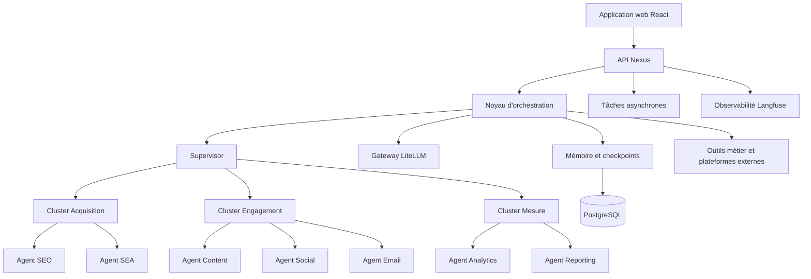

# Nexus AI

## Présentation complète, architecture technique et vision

**Nexus AI** est une plateforme multi-agents dédiée au marketing digital. Elle se comporte comme un bureau d'intelligence artificielle capable de comprendre les objectifs d'une équipe, de répartir le travail entre des agents spécialisés, d'exécuter des tâches sur plusieurs canaux et de restituer des recommandations, des contenus et des rapports exploitables.

L'ambition de Nexus n'est pas de juxtaposer plusieurs assistants indépendants. La plateforme coordonne des expertises spécialisées dans un même workflow, conserve le contexte d'une campagne, fait intervenir un humain aux étapes sensibles et mesure la qualité des résultats produits.

## 1. Définition et positionnement

### 1.1 Ce que Nexus AI est

Nexus AI est :

- un système d'orchestration de workflows marketing ;
- une équipe d'agents spécialisés pour l'acquisition, l'engagement et la mesure ;
- une interface de pilotage des campagnes et des tâches longues ;
- une couche d'accès unifiée à plusieurs modèles de langage ;
- un système de mémoire, de suivi et d'observabilité des exécutions ;
- une plateforme conçue pour combiner automatisation et validation humaine.

### 1.2 Problème traité

Les équipes marketing doivent passer d'un outil à l'autre pour rechercher des mots-clés, préparer des annonces, rédiger du contenu, gérer les réseaux sociaux, construire des séquences email, analyser les performances et produire des rapports. Cette fragmentation provoque une perte de contexte, des tâches répétitives et une faible traçabilité des décisions.

Nexus centralise ces opérations dans un environnement où les agents partagent un état de campagne contrôlé et où chaque étape peut être observée, évaluée et reprise.

### 1.3 Utilisateurs cibles

| Profil | Besoins principaux |
| --- | --- |
| Responsable marketing | Définir les objectifs, arbitrer les canaux et valider les campagnes |
| Spécialiste SEO/SEA | Analyser la visibilité, produire des recommandations et préparer les activations |
| Content manager | Générer, réviser et décliner des contenus conformes à la marque |
| Direction | Suivre les résultats, les coûts, les risques et le retour sur investissement |

### 1.4 Périmètre de décision

Nexus distingue toujours la suggestion, la préparation et l'exécution. Les agents peuvent analyser et proposer ; une publication, un envoi, une modification budgétaire ou une action ayant un impact commercial doit passer par la politique de validation de l'organisation.

## 2. Capacités fonctionnelles

### 2.1 Agents spécialisés

| Agent | Responsabilités principales |
| --- | --- |
| Orchestrateur | Compréhension de l'objectif, planification, routage et arbitrage |
| SEO | Recherche de mots-clés, audit technique, briefs et priorisation |
| SEA | Préparation d'annonces, variantes de messages et analyse des campagnes payantes |
| Content | Articles, pages d'atterrissage, publications et contenus longs |
| Social | Tendances, sentiment, angles éditoriaux et déclinaisons sociales |
| Email | Segmentation, personnalisation et séquences de messages |
| Analytics | Analyse cross-canal, anomalies, attribution et recommandations |
| Reporting | Synthèse des résultats, rapports lisibles et décisions proposées |
| Créatif | Concepts, directions créatives et déclinaisons de campagne |

Les agents utilisent des outils métier pour consulter les données de campagne, produire des livrables et préparer des actions. Toute action engageante reste soumise à la politique de validation définie par l'organisation.

### 2.2 Workflow type

1. Définition d'un objectif et d'une audience.
2. Analyse du contexte, du marché et des canaux disponibles.
3. Génération de propositions par plusieurs agents.
4. Évaluation selon des critères marketing, SEO, conformité et ton de marque.
5. Révision des livrables jusqu'à atteindre un seuil de qualité.
6. Validation humaine avant toute action engageante.
7. Lancement ou export de la campagne.
8. Mesure des résultats et génération d'un rapport.

### 2.3 Sorties attendues

Chaque workflow doit produire un résultat structuré : objectif traité, contexte utilisé, agents impliqués, propositions, critères d'évaluation, validations, actions exécutées, métriques et éléments restant à vérifier. Cette structure permet de comparer les campagnes et de reprendre une tâche sans dépendre d'un historique conversationnel implicite.

## 3. Architecture logique

### 3.1 Orchestration par graphe d'état

LangGraph constitue la couche d'orchestration. Chaque workflow est décrit comme un graphe d'état composé de nœuds, d'arêtes conditionnelles et de sous-graphes spécialisés.

Le pattern retenu est un supervisor limité à trois clusters :

- **Acquisition** : attirer et qualifier l'audience ;
- **Engagement** : produire et diffuser des contenus adaptés ;
- **Mesure** : analyser, expliquer et recommander.

Les tâches complexes peuvent être décomposées selon un pattern orchestrator-worker, tandis que les sorties générées peuvent passer dans une boucle generator-evaluator.

### 3.2 Contrôle humain

Les workflows peuvent être suspendus à des checkpoints avant une publication, une modification de campagne, l'envoi d'un message ou toute autre action présentant un impact commercial ou réputationnel. L'humain reçoit le contexte, la proposition de l'agent, les éléments justificatifs et les options de décision.

### 3.3 Mémoire et reprise

La mémoire courte durée correspond à l'état courant d'un thread et à ses checkpoints. La mémoire longue durée conserve les préférences de marque, audiences, historiques de campagnes, règles éditoriales et résultats validés.

| Environnement | Persistence | Usage |
| --- | --- | --- |
| Développement | `MemorySaver` | Prototypage rapide |
| Tests locaux | `SqliteSaver` | Reprise entre redémarrages |
| Production | `PostgresSaver` | Reprise, haute disponibilité et scaling horizontal |

## 4. Architecture applicative

### 4.1 Backend Python

Le backend est organisé autour des responsabilités suivantes :

- `agents/` : agents marketing spécialisés ;
- `core/` : état, routage, mémoire et graphes ;
- `llm/` : gateway, fournisseurs et stratégie de routage ;
- `pytorch_models/` : classification, embeddings, scoring et détection d'anomalies ;
- `api/` : routes REST, WebSocket et SSE ;
- `tasks/` : traitement asynchrone et workers ;
- `tools/` : intégrations avec les plateformes externes ;
- `db/` : modèles ORM, repositories et migrations ;
- `config/` : configuration par environnement.

### 4.2 Frontend web

L'application web React et TypeScript fournit le pilotage des agents et des campagnes, le suivi des exécutions, la visualisation des contenus et recommandations, la consultation des rapports et la validation humaine des actions sensibles.

### 4.3 Communication et tâches longues

Les opérations LLM et les traitements de campagne peuvent durer plusieurs secondes ou minutes. L'API déclenche les tâches longues en arrière-plan, tandis que SSE et WebSocket remontent la progression, les changements de statut et les résultats intermédiaires.

### 4.4 Contrats et modèle de données

Les contrats doivent versionner les organisations, utilisateurs, rôles, campagnes, audiences, canaux, tâches, exécutions de graphes, contenus, validations, métriques, rapports et connexions externes. Les actions vers une plateforme tierce doivent posséder un identifiant d'idempotence, un statut explicite et une trace de la validation qui les a autorisées.

## 5. Couche modèles et inférence

### 5.1 Gateway LiteLLM

LiteLLM fournit un point d'accès compatible avec l'interface OpenAI pour les agents. Il masque la différence entre modèles locaux et fournisseurs cloud, centralise les alias, les limites, les fallbacks, les budgets et le tracing.

### 5.2 Trois modes d'exécution

| Mode | Infrastructure | Cas d'usage |
| --- | --- | --- |
| Local | Ollama en développement, vLLM en production | Confidentialité et contrôle de l'infrastructure |
| API | Fournisseurs cloud compatibles | Démarrage rapide sans GPU |
| Hybride | Routage local/cloud par politique | Équilibre coût, latence et sensibilité |

Le mode hybride peut décider selon la complexité de la tâche, la sensibilité des données, la charge GPU et le budget journalier. Le code des agents reste inchangé lorsque la stratégie de serving évolue.

### 5.3 Répartition indicative des modèles

- modèle de raisonnement fort pour l'orchestrateur et l'analytics ;
- modèle multilingue pour la génération longue et le contenu francophone ;
- modèle léger pour la classification, le routage et les analyses rapides.

Le choix définitif doit être confirmé par des benchmarks sur les workloads Nexus, et non par un classement général de modèles.

## 6. Données, sécurité et observabilité

Le modèle de données doit couvrir au minimum les organisations, utilisateurs, campagnes, audiences, canaux, tâches, exécutions de graphes, contenus, validations, métriques, rapports et connexions aux plateformes externes.

Les principes de sécurité sont l'isolation par organisation, la gestion des rôles, la séparation entre suggestion et action, la protection des secrets, la journalisation des décisions, la limitation des outils et le contrôle des données transmises aux fournisseurs externes.

Langfuse est prévu comme couche self-hosted d'observabilité LLM pour suivre les traces, nœuds du graphe, latence, tokens, coûts, erreurs, boucles et qualité. Chaque fan-out parallèle doit être suivi d'une validation des résultats attendus et chaque boucle d'optimisation doit avoir une limite explicite.

### 6.1 Garde-fous opérationnels

- isolation stricte par organisation et par rôle ;
- secrets et connexions externes gérés hors du code ;
- allowlist des outils et permissions distinctes entre lecture, préparation et écriture ;
- approbation humaine avant toute action engageante ;
- limites de budget, tokens, durée, retries et profondeur de boucle ;
- masquage des données sensibles avant appel à un fournisseur externe ;
- journalisation de la décision, de l'outil appelé et du résultat retourné ;
- possibilité d'annuler ou de suspendre une exécution longue.

## 7. Fiabilité et exploitation

Nexus doit fournir des retries ciblés par nœud, des timeouts configurables, la reprise depuis un checkpoint, l'exécution idempotente des actions externes, des fallbacks LLM, le suivi des tâches échouées et des rapports partiels en cas d'interruption.

Le déploiement est prévu autour de conteneurs Docker, d'un reverse proxy, de PostgreSQL et d'une infrastructure de monitoring avec Prometheus et Grafana.

### 7.1 Indicateurs cibles

| Domaine | Indicateur cible |
| --- | --- |
| Qualité | Taux de sorties validées, révisions nécessaires et conformité au ton de marque |
| Performance | Latence p95 par nœud, durée totale d'un workflow et taux de timeout |
| Coûts | Tokens, coût par workflow, coût par canal et efficacité des fallbacks |
| Fiabilité | Taux de reprise depuis checkpoint, actions idempotentes et tâches échouées |
| Business | Conversion, engagement, coût d'acquisition et retour sur investissement |

## 8. Positionnement stratégique et analyse de marché

> Cette section présente une analyse de marché et des hypothèses de positionnement à confirmer par des benchmarks, une veille commerciale et des entretiens avec les équipes marketing, techniques et conformité.

### 8.1 État de l'art mondial en 2026

Le marketing augmenté par l'intelligence artificielle évolue d'une génération de textes isolée vers des écosystèmes d'agents collaboratifs orchestrés par des workflows explicites. La valeur ne réside plus uniquement dans le modèle de langage, mais dans la capacité à conserver le contexte d'une campagne, exécuter les tâches au bon moment, faire valider les actions sensibles et mesurer les résultats.

#### 8.1.1 Tendances technologiques

- **Architectures multi-agents :** les graphes d'état, notamment avec LangGraph, permettent de séquencer les étapes, d'exécuter des branches en parallèle et de conditionner les transitions.
- **Routage hybride des modèles :** les passerelles comme LiteLLM facilitent le choix entre modèles locaux et fournisseurs cloud selon le coût, la sensibilité, la latence et la charge.
- **Human-in-the-Loop asynchrone :** les campagnes peuvent être suspendues sur checkpoint avant une publication, un envoi, une modification budgétaire ou toute autre action engageante.
- **Observabilité des workflows :** les équipes attendent une visibilité sur les nœuds du graphe, les appels modèles, les tokens, les coûts, les erreurs, les boucles et les résultats ; Langfuse représente une approche adaptée à ce besoin.
- **Mémoire persistante :** la mémoire de campagne et les préférences de marque doivent survivre aux redémarrages grâce à des checkpoints et une persistence de type PostgresSaver.

#### 8.1.2 Standards et attentes des acheteurs

Les entreprises recherchent des plateformes capables de fournir :

- une isolation stricte des données par organisation et par rôle ;
- une idempotence des actions vers les plateformes externes ;
- une traçabilité de la provenance des contenus et des décisions ;
- une conformité avec les règles de protection des données et les politiques publicitaires ;
- une maîtrise du ton, des règles et de la ligne éditoriale de la marque ;
- un ROI mesurable, une baisse des coûts d'inférence et une visibilité sur les dépenses ;
- une validation humaine avant les actions commerciales ou réputationnelles.

### 8.2 Analyse concurrentielle

| Solution | Positionnement | Fonctionnalités principales | Forces | Limites | Déploiement | Maturité |
| --- | --- | --- | --- | --- | --- | --- |
| Jasper AI / Copy.ai | Génération de contenu pour copywriters | Articles, annonces, templates et voix de marque | Interface fluide et adoption rapide par les équipes créatives | Approche moins orientée orchestration complexe, faible visibilité sur les décisions multi-agents | SaaS cloud | Élevée |
| HubSpot AI | Suite CRM et marketing augmentée par l'IA | Scoring de leads, emails, automatisation CRM et contenus | Intégration native avec les données clients et le pipeline commercial | Écosystème fermé, coût élevé et personnalisation limitée des agents | SaaS cloud propriétaire | Mature |
| Salesforce Einstein / Agentforce | CRM d'entreprise et automatisation des processus | Données CRM, agents commerciaux, campagnes et reporting | Écosystème très large et intégration profonde aux processus d'entreprise | Dépendance à la plateforme, coût et complexité d'intégration | SaaS cloud propriétaire | Mature |
| CrewAI / LangGraph | Frameworks de développement d'agents | Graphes, agents, outils et workflows personnalisés | Flexibilité technique et contrôle complet du code | Nécessite une équipe d'ingénierie, pas de produit marketing prêt à l'emploi | Open source ou code hébergé | Émergente |
| Nexus AI | Bureau marketing multi-agents orchestré | Workflows cross-canal, mémoire de campagne, checkpoints, LiteLLM et reporting | Approche applicative souveraine, hybride, observable et orientée processus | Connecteurs et validateurs de graphes encore à industrialiser | Cloud ou self-hosted hybride | En développement / MVP avancé |

Nexus AI se positionne entre les assistants SaaS fermés et les frameworks d'agents destinés aux développeurs. Il vise une plateforme applicative prête à l'emploi, centrée sur les processus marketing, tout en conservant la flexibilité des graphes et la maîtrise des données d'une architecture self-hosted.

### 8.3 Différenciation stratégique

| Axe | Différenciation de Nexus AI |
| --- | --- |
| Orchestration | Graphes d'état, supervisor, sous-graphes spécialisés, boucles d'évaluation et reprise sur checkpoint |
| Modèles | Gateway LiteLLM avec routage entre modèles locaux vLLM/Ollama et fournisseurs cloud |
| Coûts | Possibilité de réserver les modèles cloud aux tâches complexes et d'exécuter localement les traitements sensibles ou répétitifs |
| Contrôle | Validation humaine avant publication, envoi, modification de budget ou autre action engageante |
| Observabilité | Suivi des traces, nœuds, tokens, latence, coûts, erreurs et qualité avec une couche de type Langfuse |
| Souveraineté | Déploiement self-hosted, isolation par organisation et conservation maîtrisée des données de campagne |
| Processus métier | Agents spécialisés pour l'acquisition, l'engagement, la mesure, le contenu, le social, l'email et le reporting |

#### Existant et vision cible

**Disponible aujourd'hui :** les fondations du backend multi-agents, la structure des graphes d'état, le routage LiteLLM, l'interface de pilotage React, les tâches asynchrones, la mémoire et les principes de validation humaine sont documentés dans le projet.

**Vision cible :** proposer une bibliothèque de workflows marketing packagés, des connecteurs bidirectionnels sécurisés et idempotents, des validateurs de graphes, une mémoire de marque durable et une optimisation des décisions à partir des résultats validés.

### 8.4 Modèle économique et grille tarifaire indicative

Le modèle recommandé combine SaaS, licence d'exploitation Enterprise et facturation à l'usage au-delà des quotas. Les montants ci-dessous sont des hypothèses à valider par des entretiens commerciaux et des tests de disposition à payer.

| Segment | Cible principale | Services inclus | Fourchette indicative | Déploiement |
| --- | --- | --- | --- | --- |
| Free / Developer | Développeurs, indépendants et équipes en évaluation | Environnement local, workflows limités, MemorySaver et quotas API réduits | Gratuit ou quotas limités | Local ou cloud limité |
| Pro | Indépendants, PME et petites agences | Cloud géré, agents standards, connecteurs marketing, quotas LLM et suivi des coûts | 49 à 149 EUR par utilisateur et par mois | SaaS partagé |
| Enterprise | Grandes entreprises, agences et organisations réglementées | Licence d'infrastructure, SSO, RBAC, support, connecteurs avancés, conformité et reporting consolidé | À partir d'environ 1 500 EUR par mois, sur devis | Self-hosted ou cloud dédié |

La tarification peut combiner un abonnement par siège, une consommation de tokens au-delà des quotas et des services d'intégration. Les hypothèses à vérifier sont l'élasticité prix des PME, la valeur perçue des connecteurs et l'appétence des grands comptes pour l'hébergement on-premise.

### 8.5 Opportunité géographique et sectorielle

Les marchés émergents et les régions à forte croissance numérique, notamment l'Afrique francophone et l'Europe continentale, recherchent des outils capables de respecter les langues, les pratiques éditoriales, les contraintes de connectivité et les budgets d'acquisition locaux.

Nexus AI peut répondre à cette opportunité grâce à :

- un routage multilingue et des modèles adaptés aux contenus francophones ;
- un fonctionnement local ou hybride pour les organisations qui ne peuvent pas transmettre leurs données à des fournisseurs externes ;
- une réduction de la complexité technique grâce à une interface de pilotage et des agents spécialisés ;
- une maîtrise des coûts grâce au choix dynamique du modèle et au suivi des tokens ;
- une architecture adaptable aux agences, institutions, entreprises et équipes marketing internes.

Les exigences réglementaires, la localisation des données, les politiques publicitaires et les contrats des plateformes externes doivent être étudiés pays par pays avant un déploiement commercial.

### 8.6 Personas cibles

| Persona | Secteur | Problème | Attente | Fonctionnalité attendue | Décision d'achat | Priorité |
| --- | --- | --- | --- | --- | --- | --- |
| Directeur marketing / CMO | Retail et services | Outils fragmentés, faible visibilité sur les coûts et les performances | Unifier les canaux, maîtriser le budget et protéger la marque | Tableau de bord central, rapports consolidés et validation globale | Validateur et décideur budgétaire | Élevée |
| Responsable SEO/SEA | Agence digitale | Audits, recherche de mots-clés et annonces répétitifs | Accélérer les briefs et l'analyse de trafic | Agents SEO/SEA et intégrations publicitaires | Prescripteur technique | Élevée |
| Content manager | E-commerce et médias | Production multicanal à grande échelle sans perdre le ton de marque | Automatiser les déclinaisons tout en gardant une qualité éditoriale | Agents Content/Social et boucle générateur-évaluateur | Utilisateur clé | Moyenne |
| RSSI ou DSI | Tous secteurs | Risque de fuite de données vers les fournisseurs LLM tiers | Garantir conformité, isolation et souveraineté | Mode local/hybride, RBAC, gestion des secrets et audit | Approbation technique | Élevée |

### 8.7 Risques et limites

- **Risque technique :** des graphes complexes peuvent boucler, augmenter la latence ou produire des états difficiles à reprendre ; les limites d'itérations et timeouts sont obligatoires.
- **Risque commercial :** les suites comme HubSpot ou Salesforce peuvent intégrer nativement des agents et bénéficier d'un avantage de distribution.
- **Risque réglementaire :** une hallucination peut générer un contenu ou une action non conforme si la validation humaine est contournée.
- **Risque lié aux données :** les informations de campagne, audiences et performances peuvent être sensibles et doivent rester isolées par organisation.
- **Risque lié aux modèles :** les variations de performance et de prix des fournisseurs cloud rendent les coûts d'inférence imprévisibles sans budget, quotas et fallback.
- **Limite de mesure :** le ton de marque, la créativité et la pertinence éditoriale restent partiellement subjectifs et nécessitent des évaluations humaines.
- **Validation externe :** les connecteurs tiers, la charge de PostgresSaver et les contrôles de sécurité doivent être testés avant une promesse Enterprise.

### 8.8 Synthèse du positionnement

Nexus AI se positionne comme une infrastructure d'orchestration marketing intelligente, souveraine et contrôlable, et non comme un simple générateur de texte. Les graphes d'agents, la gateway de modèles hybride, la mémoire persistante, l'observabilité et le Human-in-the-Loop répondent à la fragmentation des outils tout en donnant aux entreprises la maîtrise de leurs coûts, de leurs données et de leurs décisions.

## 9. Vision produit

### Court terme

Faire de Nexus un poste de travail fiable pour créer, piloter et mesurer des campagnes assistées par IA, avec des workflows maîtrisés, une validation humaine claire et une visibilité complète sur les coûts.

### Moyen terme

Construire une bibliothèque de workflows réutilisables, des agents configurables par secteur, une mémoire de marque durable et des connecteurs vers les plateformes marketing les plus utilisées.

### Long terme

Faire évoluer Nexus vers un système d'exploitation marketing intelligent : comprendre les objectifs business, proposer une stratégie multi-canal, exécuter les tâches autorisées, mesurer leur impact et améliorer ses recommandations à partir des résultats validés.

## 10. Principes directeurs

1. **L'humain garde la décision finale** sur les actions engageantes.
2. **L'état est explicite et traçable** : une campagne ne doit pas dépendre d'un contexte implicite.
3. **Les agents sont spécialisés** : chacun possède un périmètre et des critères de qualité identifiables.
4. **Le modèle est interchangeable** : le produit ne doit pas être prisonnier d'un fournisseur.
5. **La qualité est mesurée** : chaque sortie importante doit pouvoir être évaluée et révisée.
6. **La souveraineté est configurable** : les données sensibles peuvent rester sur une infrastructure contrôlée.

## 11. État et trajectoire

Le dépôt présente déjà les fondations d'un backend multi-agents, d'un frontend de pilotage, d'une couche LLM, de tâches asynchrones, d'outils métier et d'une infrastructure d'exploitation. La trajectoire cible consiste à consolider ces briques autour de contrats de données stables, de workflows observables, de tests de graphes et de politiques de sécurité applicables à chaque outil.

### 11.1 Priorités techniques

1. Stabiliser l'état de campagne, les contrats des agents et les événements de workflow.
2. Finaliser les checkpoints, la reprise et le contrôle humain sur les actions engageantes.
3. Ajouter les connecteurs externes avec permissions minimales, idempotence et journal d'audit.
4. Mettre en place les évaluations de sorties, les tests de graphes et les benchmarks de modèles.
5. Industrialiser l'observabilité des tokens, coûts, erreurs, boucles et résultats métier.
